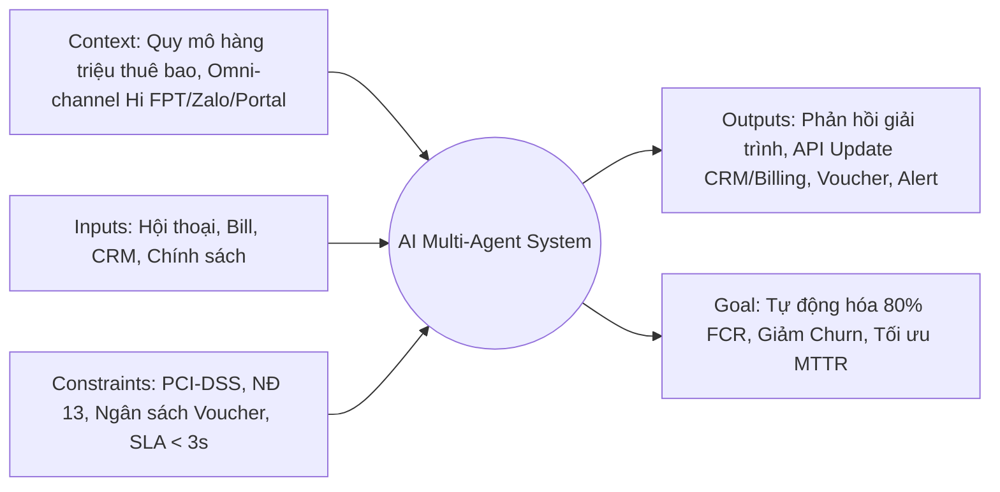
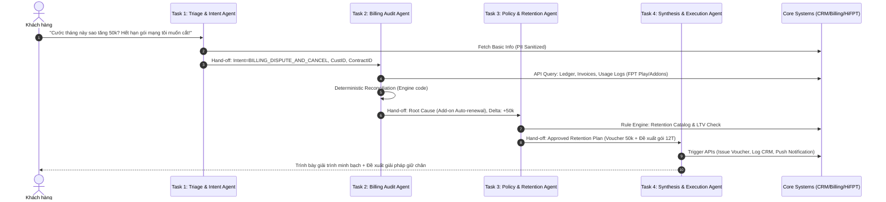
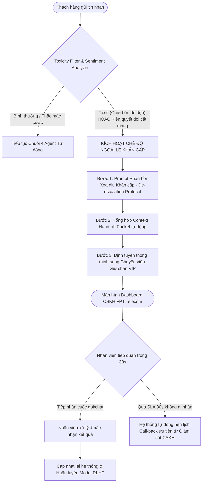

# TÀI LIỆU THIẾT KẾ KIẾN TRÚC HỆ THỐNG AI AGENT (AI ARCHITECTURE DESIGN DOCUMENT)

**Dự án:** Hệ thống Tác tử Tự động hóa Xử lý Khiếu nại Cước & Gia hạn Thuê bao (Automated Billing Dispute & Retention Agentic System)  
**Khách hàng:** FPT Telecom (Hạ tầng Viễn thông & Dịch vụ FPT Play)  
**Tác giả:** AI Solutions Architect  
**Phiên bản:** 1.0  
**Tiêu chuẩn bảo mật & tuân thủ:** Nghị định 13/2023/NĐ-CP (Bảo vệ dữ liệu cá nhân), PCI-DSS (Thanh toán)

---

## 1. THIẾT LẬP KHUNG ĐỊNH HÌNH KIẾN TRÚC GIC-IO

Khung GIC-IO (Goal – Inputs – Constraints – Outputs – Context) đóng vai trò là kim chỉ nam định nghĩa phạm vi nghiệp vụ, ranh giới an toàn và mục tiêu vận hành của hệ thống Multi-Agent trước khi triển khai kỹ thuật.



### 1.1. Goal (Mục tiêu hệ thống)
* **Mục tiêu định lượng (Quantitative KPIs):**
  * **Tỷ lệ giải quyết dứt điểm tại điểm chạm đầu tiên (First Contact Resolution - FCR):** Đạt tối thiểu **75% – 85%** các trường hợp khiếu nại cước thông thường mà không cần nhân viên can thiệp.
  * **Thời gian xử lý trung bình (MTTR - Mean Time to Resolve):** Rút ngắn từ **4 – 24 giờ** (xử lý thủ công qua ticket) xuống dưới **45 giây** (tương tác trực tiếp thời gian thực).
  * **Tỷ lệ chuyển đổi gia hạn (Retention Rate):** Tăng **15%** tỷ lệ gia hạn thành công cho nhóm thuê bao cáp quang / combo FPT Play cận ngày đáo hạn gói cước 6T/12T.
  * **Chi phí vận hành (OpEx Reduction):** Cắt giảm **60%** tải công việc đối soát thủ công của bộ phận Chăm sóc khách hàng (CS) và Kế toán cước.
* **Mục tiêu định tính (Qualitative Goals):**
  * Nâng cao trải nghiệm khách hàng (CSAT > 4.5/5; NPS tăng 8-10 điểm).
  * Minh bạch hóa 100% dòng tiền, phí dịch vụ phát sinh (gói kênh FPT Play, phim VOD, phí IP tĩnh, thiết bị mở rộng WiFi 6).

### 1.2. Inputs (Dữ liệu đầu vào)
* **Dữ liệu phi cấu trúc (Unstructured Data):**
  * Chuỗi văn bản/giọng nói (STT transcript) phản ánh từ khách hàng qua ứng dụng **Hi FPT**, Zalo OA, Web Portal hoặc Hotline 1900 6600.
  * Lịch sử tương tác, nhật ký phản ánh cũ trong 90 ngày gần nhất lưu trữ trên CRM.
* **Dữ liệu có cấu trúc (Structured Enterprise Data):**
  * **Contract & Subscriber ID:** Số hợp đồng (vd: `HND123456`), mã khách hàng, loại gói cước (Giga, Sky, Meta, FPT Play VIP/SVIP).
  * **Billing & Ledger Master Data:** Lịch sử cước 6-12 tháng, nhật ký thanh toán thực tế (Auto-debit, Foxpay, VnPay, chuyển khoản ngân hàng), công nợ tồn đọng.
  * **Usage & Event Logs:** Dữ liệu tiêu dùng dịch vụ từ hệ thống BSS/OSS (Lịch sử thuê phim FPT Play, dịch vụ Ultra Fast, IP động/tĩnh, nhật ký bật/tắt thiết bị).
  * **Promotional Policy Engine:** Bảng quy tắc chiết khấu, chương trình tặng tháng (khuyến mại trả trước 6T tặng 1T, 12T tặng 2T), catalog voucher bù trừ hợp lệ.

### 1.3. Constraints (Ràng buộc kỹ thuật, bảo mật & tài chính)
* **Bảo mật và Quyền riêng tư (Security & Compliance):**
  * **Masking PII (Personally Identifiable Information):** Tuân thủ Nghị định 13/2023/NĐ-CP; che mặt định danh (ẩn CCCD, 4 số cuối thẻ tín dụng, địa chỉ lắp đặt chi tiết) trước khi dữ liệu được truyền vào mô hình ngôn ngữ lớn (LLM).
  * **Data Residency:** Mọi tiến trình tính toán và dữ liệu tài chính không được rời khỏi VPC nội bộ (Private Cloud của FPT Telecom) hoặc cụm dịch vụ được mã hóa đạt chuẩn PCI-DSS Level 1.
* **Hạn mức tài chính & Phân quyền (Financial Safeguards):**
  * **Voucher Hard Limit:** Agent chỉ có quyền tự động cấp bù cước hoặc phát voucher giảm giá tối đa **≤ 10% giá trị gói cước** hoặc trần cứng **≤ 100.000 VNĐ/thuê bao/chu kỳ**.
  * Bất kỳ khoản hoàn tiền mặt (Cash refund) hoặc điều chỉnh hóa đơn vượt ngưỡng trên bắt buộc phải chuyển sang luồng phê duyệt của Kế toán trưởng chi nhánh (Human-in-the-loop).
* **Độ trễ hệ thống (Latency SLAs):**
  * Phản hồi tương tác từng lượt (Turn-around time) qua WebSocket/Chat stream: **≤ 2.5 giây**.
  * Tác vụ trích xuất & đối soát dữ liệu đa hệ thống (Database reconciliation): **≤ 1.5 giây**.
* **Độ chính xác và Tính Tất định (Deterministic Integrity):**
  * Tuyệt đối không để LLM tự tính toán số học (no LLM math hallucination). Toàn bộ số liệu tiền tệ, cước phí phải được tính bằng Code Execution Sandbox / API Backend kế toán và đưa vào Prompt dưới dạng tham số bất biến.

### 1.4. Outputs (Dữ liệu đầu ra)
* **Tương tác khách hàng (External Facing):**
  * Bảng phân tích cước đối soát cá nhân hóa (Personalized Explanation Breakdown) dạng trực quan, minh bạch từng khoản chênh lệch.
  * Lời mời gia hạn kèm kịch bản ưu đãi may-đo (Personalized Retention Proposal).
  * Mã e-Voucher giảm giá hoặc link xác nhận thanh toán/gia hạn 1-click tích hợp qua cổng Foxpay/Hi FPT.
* **Giao dịch hệ thống (Internal System Actions):**
  * Payload API điều chỉnh trạng thái hợp đồng trên Core Billing (Status: `RENEWED`, `IN_DISPUTE`, `DISCOUNT_APPLIED`).
  * Cập nhật bản ghi Ticket trên FPT CRM với đầy đủ phân loại nguyên nhân khiếu nại (Billing Root Cause Classification Tag).
  * Sự kiện Webhook kích hoạt bộ phận kỹ thuật kiểm tra (nếu phát hiện khiếu nại cước do lỗi suy hao đường truyền/mất kết nối).

### 1.5. Context (Bối cảnh vận hành đặc thù)
* **Quy mô:** Hơn 4 triệu thuê bao băng rộng cố định và hàng triệu tài khoản OTT FPT Play hoạt động đồng thời; lưu lượng khiếu nại tăng vọt 300% vào chu kỳ xuất hóa đơn (ngày 1 - 5 hàng tháng) và thời điểm hết hạn hợp đồng đóng trước.
* **Kiến trúc hệ thống hỗn hợp (Heterogeneous Legacy):** Dữ liệu nằm phân mảnh giữa Core Billing cũ (Billing V2/Oracle Financials), BSS/OSS mạng viễn thông, và nền tảng dịch vụ FPT Play Cloud. AI Agent phải tương tác qua tầng API Gateway trung gian (Middleware/ESB).
* **Tâm lý khách hàng viễn thông:** Cực kỳ nhạy cảm với sự chênh lệch tiền cước dù chỉ từ 10.000 – 20.000 VNĐ; tâm lý dễ nổi nóng nếu gặp bot trả lời vòng vo, dập khuôn.

---

## 2. PHÂN RÃ QUY TRÌNH (TASK DECOMPOSITION - 4 AGENT CHAIN)

Quy trình tự động hóa được thiết kế theo mô hình **Chuỗi Tác tử Chuyên môn hóa (Specialized Multi-Agent Sequential Chain)** kết hợp **Deterministic State Machine** để loại bỏ hoàn toàn rủi ro sai sót số liệu.



---

### Bảng Phân Rã Chi Tiết 4 Nhiệm Vụ Con

#### Nhiệm vụ 1: Phân loại, Định danh Ý định & Khai thác Thực thể (Triage & Intent Understanding Agent)
| Trường thông tin | Đặc tả kỹ thuật |
| :--- | :--- |
| **Tên nhiệm vụ** | **Triage & Intent Understanding Agent** |
| **Chức năng** | - Tiếp nhận tin nhắn/phản ánh từ khách hàng qua cổng đa kênh.<br>- Chuẩn hóa ngôn ngữ, khử nhiễu (teencode, lỗi gõ dấu).<br>- Phân loại ý định kép (*Multi-intent classification*): Khiếu nại cước (*Billing Dispute*), Yêu cầu giải thích (*Invoice Clarification*), Dọa hủy hợp đồng (*Churn Warning*), Gia hạn (*Renewal Inquiry*).<br>- Trích xuất thực thể (Named Entity Recognition - NER): Số hợp đồng, tháng khiếu nại, số tiền thắc mắc.<br>- Thực hiện che thông tin cá nhân (PII Masking). |
| **Công cụ / API kích hoạt** | 1. `Enterprise_Guardrail_Service`: Lọc từ ngữ độc hại, kiểm duyệt đầu vào.<br>2. `NLP_Entity_Extractor_Tool`: Trích xuất Contract_ID, Phone, Time_Frame.<br>3. `Customer_Resolution_API`: Tra cứu Customer_ID từ số điện thoại đã xác thực qua SSO Hi FPT. |
| **Dữ liệu bàn giao (Hand-off Data)** | Định dạng JSON truyền sang Task 2:<br>```json<br>{<br>  "trace_id": "req-fpt-8921389",<br>  "customer_id": "CUST_789456",<br>  "contract_id": "HND987654",<br>  "primary_intent": "BILLING_DISPUTE",<br>  "secondary_intent": "CHURN_RISK",<br>  "dispute_month": "2026-10",<br>  "claimed_discrepancy_amount": 50000,<br>  "sentiment_score": -0.65,<br>  "timestamp": "2026-11-06T04:59:00Z"<br>}<br>``` |

---

#### Nhiệm vụ 2: Truy vấn, Đối soát & Kiểm toán Cước (Billing Audit & Reconciliation Agent)
| Trường thông tin | Đặc tả kỹ thuật |
| :--- | :--- |
| **Tên nhiệm vụ** | **Billing Audit & Reconciliation Agent** |
| **Chức năng** | - Nhận thông tin hợp đồng và tháng khiếu nại.<br>- Gọi song song (Parallel execution) các hệ thống cơ sở dữ liệu cước, khuyến mãi và nhật ký tiêu dùng thực tế.<br>- Kích hoạt mã Python thực thi đối soát tất định (Deterministic Code Sandbox): Tính toán chênh lệch cước kỳ hiện tại so với kỳ trước.<br>- Xác định **Nguyên nhân gốc rễ (Root Cause)**: Lỗi hệ thống tính sai, hết hạn thời gian khuyến mại (hết hạn 6T/12T trở về giá gốc), phát sinh cước thuê phim FPT Play VOD, tự động gia hạn gói thể thao, hay do thanh toán trễ bị cộng dồn kỳ trước. |
| **Công cụ / API kích hoạt** | 1. `Billing_Engine_GetInvoiceDetails(contract_id, month)`: Lấy hóa đơn bóc tách.<br>2. `OSS_Usage_GetEventLogs(contract_id, month)`: Kiểm tra nhật ký phát sinh phụ phí FPT Play/Add-on IP.<br>3. `Promo_Master_GetHistory(contract_id)`: Kiểm tra trạng thái gói cước khuyến mãi.<br>4. `Deterministic_Reconciliation_Calculator`: Công cụ tính toán số học an toàn. |
| **Dữ liệu bàn giao (Hand-off Data)** | Định dạng JSON truyền sang Task 3:<br>```json<br>{<br>  "trace_id": "req-fpt-8921389",<br>  "contract_id": "HND987654",<br>  "reconciliation_status": "DISCREPANCY_FOUND",<br>  "root_cause_category": "PROMO_EXPIRED_AND_ADDON",<br>  "breakdown": {<br>    "base_plan_name": "Combo Giga + FPT Play",<br>    "previous_month_charge": 250000,<br>    "current_month_charge": 300000,<br>    "variance": 50000,<br>    "reasons": [<br>      {"item": "Gói khuyến mại 12 tháng hết hạn", "impact": 30000},<br>      {"item": "Tự động gia hạn Gói Kênh K+", "impact": 20000}<br>    ]<br>  },<br>  "system_fault_identified": false,<br>  "customer_payment_status": "UNPAID"<br>}<br>``` |

---

#### Nhiệm vụ 3: Đánh giá Giá trị & Ra quyết định Chính sách Giữ chân (Retention & Policy Decision Agent)
| Trường thông tin | Đặc tả kỹ thuật |
| :--- | :--- |
| **Tên nhiệm vụ** | **Retention & Policy Decision Agent** |
| **Chức năng** | - Tiếp nhận nguyên nhân chênh lệch cước và hồ sơ khách hàng.<br>- Phân tích chỉ số giá trị trọn đời (Customer Lifetime Value - CLV/LTV), thâm niên sử dụng dịch vụ và lịch sử khiếu nại.<br>- Vận hành ma trận ra quyết định giữ chân (Retention Decision Matrix):<br>  + Nếu là lỗi hệ thống: Cấp mã đền bù/điều chỉnh hóa đơn 100% phần lỗi.<br>  + Nếu do khách hàng chưa hiểu chính sách cước + có nguy cơ rời bỏ: Đề xuất gói gia hạn ưu đãi dài hạn (vd: Đóng 6T tặng 1T, giữ nguyên giá cũ) kèm voucher hỗ trợ chuyển tiếp.<br>- Kiểm tra trần ngân sách ủy quyền (Policy Guardrails) để đảm bảo Agent không duyệt vượt thẩm quyền tài chính. |
| **Công cụ / API kích hoạt** | 1. `CRM_GetCustomerProfile_LTV(customer_id)`: Lấy điểm tín nhiệm, hạng thành viên (Vàng, Bạc, Kim Cương), LTV.<br>2. `Decision_Rules_Engine_Evaluate(LTV_tier, root_cause, risk_level)`: Trả về gói chính sách hợp lệ.<br>3. `Budget_Allocation_Validator(voucher_value, customer_id)`: Kiểm tra hạn mức chiết khấu theo quy định tài chính FPT Telecom. |
| **Dữ liệu bàn giao (Hand-off Data)** | Định dạng JSON truyền sang Task 4:<br>```json<br>{<br>  "trace_id": "req-fpt-8921389",<br>  "customer_id": "CUST_789456",<br>  "decision_type": "RESOLVE_AND_UPSELL_RETENTION",<br>  "approved_concession": {<br>    "action": "ISSUE_COMPENSATION_VOUCHER",<br>    "voucher_code_type": "VOUCHER_TRANSITION_50K",<br>    "value": 50000,<br>    "valid_for_renewal": true<br>  },<br>  "recommended_retention_offer": {<br>    "plan_code": "COMBO_GIGA_2026_12M",<br>    "description": "Gia hạn 12 tháng: Giữ nguyên đơn giá cũ 250k/tháng + Tặng thêm 01 tháng cước + Miễn phí nâng băng thông",<br>    "prepaid_amount": 3000000<br>  },<br>  "auth_level": "AUTO_APPROVED_WITHIN_BUDGET"<br>}<br>``` |

---

#### Nhiệm vụ 4: Tổng hợp Phản hồi & Kích hoạt Tác vụ Thực thi (Response Synthesis & Execution Agent)
| Trường thông tin | Đặc tả kỹ thuật |
| :--- | :--- |
| **Tên nhiệm vụ** | **Response Synthesis & Execution Agent** |
| **Chức năng** | - Chuyển hóa toàn bộ dữ liệu đối soát kỹ thuật khô khan thành ngôn ngữ tự nhiên, mạch lạc, đồng cảm và chuyên nghiệp.<br>- Soạn thảo văn bản giải trình chi tiết từng dòng tiền minh bạch.<br>- Đưa ra đề xuất giải pháp xử lý win-win (Áp dụng voucher giảm trừ ngay trên hóa đơn hoặc tặng mã khi gia hạn).<br>- Đồng thời kích hoạt song song các tác vụ hệ thống (Side-effects): Khởi tạo e-voucher, cập nhật trạng thái CRM ticket, gửi thông báo đẩy (Push Notification) lên app Hi FPT. |
| **Công cụ / API kích hoạt** | 1. `HiFPT_PushNotification_API`: Đẩy thông báo kèm DeepLink thanh toán.<br>2. `Voucher_Engine_CreateAndBind(customer_id, voucher_type)`: Sinh mã voucher thực trong database.<br>3. `CRM_Ticket_CloseWithSummary(ticket_id, resolution_log)`: Lưu audit trail.<br>4. `Billing_ApplyAdjustment_Credit(contract_id, amount)`: Áp dụng trừ tiền vào kỳ thanh toán (nếu có). |
| **Dữ liệu bàn giao (Hand-off Data)** | Kết thúc chu kỳ Agent -> Trả kết quả ra Giao diện Người dùng (UI/Channel) & Ghi nhận Audit Log hoàn tất:<br>```json<br>{<br>  "status": "COMPLETED",<br>  "execution_summary": {<br>    "ticket_id": "TICK-908234",<br>    "voucher_issued": "FPT50K-AB98",<br>    "client_response_rendered": true,<br>    "crm_audit_synced": true<br>  },<br>  "delivery_channel": "HI_FPT_CHAT"<br>}<br>``` |

---

## 3. THIẾT KẾ LUỒNG NGOẠI LỆ & HUMAN-IN-THE-LOOP (HITL)

Hệ thống AI Agent không được phép vận hành như một "hộp đen" cô lập. Đối với ngành viễn thông có rủi ro churn cao, việc phát hiện phản ứng tiêu cực cực đoan (*Toxicity*) và nguy cơ rời bỏ dịch vụ cấp bách (*Imminent Churn Emergency*) đòi hỏi một cơ chế can thiệp thời gian thực của con người (**Human-in-the-loop - HITL**).



### 3.1. Tiêu chí Kích hoạt Ngoại lệ (Trigger Conditions)
Hệ thống sử dụng bộ lọc đa tầng (**Multi-layer Guardrails**) để ngắt quyền tự quyết của AI Agent ngay lập tức khi phát hiện một trong các dấu hiệu sau:

1. **Ngưỡng Độc hại & Xúc phạm (Toxicity Threshold):**
   * Sử dụng mô hình kiểm duyệt (như Llama Guard hoặc Custom Vietnamese Toxic Classifier): Chỉ số `toxicity_score > 0.8` hoặc xuất hiện các từ ngữ thóa mạ, lăng mạ nhân viên FPT, đe dọa kiện tụng ra cơ quan quản lý (Bộ TT&TT, Cục Cạnh tranh & Bảo vệ NTD).
2. **Ngưỡng Nguy cơ Rời bỏ Cực đoan (Imminent Churn Intent):**
   * Nhận diện các mẫu câu dứt khoát: *"Hủy ngay hợp đồng hôm nay", "Cắt mạng đi, tao chuyển qua mạng khác", "Kêu người đến tháo modem ngay lập tức", "Đừng giải thích lằng nhằng nữa"*.
   * Giá trị hợp đồng lớn (Doanh nghiệp, VIP Diamond, hoặc thời gian gắn bó > 5 năm) nhưng đang có `sentiment_score < -0.8`.

---

### 3.2. Quy trình Xử lý 3 Bước: Xoa Dịu -> Đóng Gói Context -> Handoff Liền Mạch

#### Bước 1: Kích hoạt Kịch bản Xoa dịu Đa tầng (De-escalation Protocol)
* **Nguyên tắc:** Không tranh cãi lý lẽ, không đẩy các bảng thống kê số liệu vào thời điểm này, không dùng câu trả lời rập khuôn mang tính máy móc.
* **Mẫu phản hồi định sẵn của Agent (System De-escalation Script):**
  > *"Dạ em hoàn toàn thấu hiểu sự bất tiện và bức xúc của Quý khách về khoản cước phát sinh chưa rõ ràng này. Em xin chân thành cáo lỗi cùng Anh/Chị.  
  > Em đã đóng băng yêu cầu này trên hệ thống và chuyển ngay hồ sơ của Anh/Chị đến **Chuyên viên Xử lý Khiếu nại Cấp cao của FPT Telecom**. Chuyên viên sẽ tiếp nhận trực tiếp và kết nối lại với Anh/Chị trong vòng **30 giây** để xử lý dứt điểm cho mình ạ!"*

#### Bước 2: Tổng hợp Gói Dữ liệu Chuyển giao Ngữ cảnh (Context Hand-off Packet)
Hệ thống AI không đẩy một trang trắng cho tư vấn viên con người. Trong vòng **500ms**, hệ thống tự động biên dịch toàn bộ dữ kiện thành một **Dossier súc tích (1-screen view)** để nhân viên con người có thể nắm bắt toàn bộ tình huống trong 5 giây đầu tiên tiếp nhận.

```json
{
  "escalation_event": {
    "ticket_id": "ESC-2026-FPT-0912",
    "timestamp": "2026-11-06T05:00:15Z",
    "priority": "CRITICAL_SEV_1",
    "routing_tag": "VIP_RETENTION_TEAM"
  },
  "customer_summary": {
    "customer_name": "Nguyễn Văn A",
    "contract_id": "HND987654",
    "customer_tier": "DIAMOND",
    "tenure_months": 48,
    "current_package": "Combo Sky + FPT Play SVIP",
    "monthly_arpu": "380.000 VNĐ",
    "churn_risk_score": 0.94
  },
  "dispute_context": {
    "issue_summary": "Khách bức xúc do hóa đơn tăng 50.000 VNĐ sau khi hết hạn 12T khuyến mãi; đe dọa cắt mạng lập tức.",
    "agent_audit_finding": "Gói cước 12T hết hạn ưu đãi (-30k) + Tự động gia hạn gói K+ (-20k). Không có lỗi hệ thống.",
    "customer_last_message": "Làm ăn lừa đảo, cước tăng vô tội vạ! Cắt mạng ngay trong ngày cho tôi!"
  },
  "ai_copilot_recommendation": {
    "suggested_human_action": "Xoa dịu -> Tặng ngay Voucher tri ân 50k vào kỳ cước này -> Mời gia hạn 12T giữ nguyên giá cũ.",
    "authorized_max_compensation": "Tối đa miễn cước 01 tháng nếu khách cam kết ở lại 12 tháng tiếp theo."
  }
}
```

#### Bước 3: Định tuyến Thông minh & Cơ chế Giám sát SLA Handoff
* **Phân bổ cuộc gọi/chat:** Đẩy thẳng vào hàng đợi ưu tiên cao nhất (**Queue: Emergency Retention Desk**) trên hệ thống FPT Contact Center Omnichannel.
* **Thời gian đáp ứng (Hand-off SLA):**
  * Trong vòng **30 giây**, nhân viên chuyên trách phải nhấn `Accept Ticket`.
  * Nếu quá **30 giây** mà nhân viên chưa tiếp nhận (do nghẽn mạng): Hệ thống tự động kích hoạt cuộc gọi Outbound Call tự động từ Trưởng ca trực CSKH hoặc gửi tin nhắn SMS có chữ ký điện tử của Giám đốc Trung tâm CSKH FPT Telecom hẹn giờ hỗ trợ trong vòng 15 phút.
* **Cơ chế Đồng bộ 2 chiều (Bidirectional Synchronization):** Mọi hành động, ghi chú và thỏa thuận sau đó của tư vấn viên con người với khách hàng đều được đẩy ngược lại Event Store để làm dữ liệu huấn luyện RLHF (Reinforcement Learning from Human Feedback), giúp AI Agent tinh chỉnh ngưỡng phân loại và phản xạ trong các trường hợp tương tự.

---

## 4. MA TRẬN ĐÁNH GIÁ RỦI RO & PHƯƠNG ÁN DỰ PHÒNG (RISK & MITIGATION MATRIX)

| Rủi ro kiến trúc | Mức độ | Hậu quả | Giải pháp kỹ thuật ngăn ngừa |
| :--- | :--- | :--- | :--- |
| **LLM Hallucination trong tính tiền** | Rất cao | Tính sai tiền cước, vi phạm quy định tài chính FPT. | **Tách biệt hoàn toàn:** LLM không thực hiện phép tính; 100% số liệu tiền bạc tính qua Code Sandbox chuyên biệt. |
| **Spam / Bot Loop Attack** | Trung bình | Khách hàng cố tình chat liên tục để vòi vĩnh voucher. | Áp dụng quy tắc kiểm soát tần suất: Mỗi hợp đồng chỉ được nhận tối đa 01 voucher bù trừ trong chu kỳ 6 tháng. |
| **Sự cố nghẽn API Core Billing** | Cao | Agent bị treo, không phản hồi được cho khách trong 2.5s. | Thiết lập **Circuit Breaker Pattern**: Nếu API Billing quá tải > 2s, chuyển sang chế độ Async ("Hệ thống đang kiểm tra, kết quả sẽ gửi qua App trong 5 phút"). |
| **Rò rỉ dữ liệu cá nhân qua Prompt** | Cực kỳ cao | Vi phạm Nghị định 13/2023/NĐ-CP, bị xử phạt pháp lý. | Tầng trung gian **PII Anonymizer** thay thế toàn bộ tên, CCCD, địa chỉ thành UUID trước khi gửi tới LLM. |

---

## 5. KẾT LUẬN & LỘ TRÌNH TRIỂN KHAI KHUYẾN NGHỊ

Bản thiết kế này chuyển hóa toàn diện quy trình xử lý khiếu nại cước thủ công của FPT Telecom thành một **Hệ sinh thái Agentic có kiểm soát**, trong đó:
1. **Khung GIC-IO** định vị rõ ranh giới an toàn, chuẩn hóa dữ liệu đầu vào - đầu ra và rào chắn tài chính.
2. **Quy trình 4 Agent chuyên biệt** giải quyết triệt để sự nhập nhằng giữa việc thấu hiểu ngôn ngữ tự nhiên và tính chính xác tuyệt đối của số liệu kế toán.
3. **Cơ chế Human-in-the-loop đa tầng** biến rủi ro khách hàng nổi giận thành cơ hội giữ chân thuê bao chiến lược, đảm bảo tôn chỉ lấy khách hàng làm trọng tâm của FPT Telecom.

**Lộ trình khuyến nghị:**
* **Giai đoạn 1 (Tuần 1 - 4):** Triển khai thử nghiệm Agent 1 & Agent 2 ở chế độ "Shadow Mode" (chạy ngầm song song với nhân viên thực tế để đo độ chính xác đối soát).
* **Giai đoạn 2 (Tuần 5 - 8):** Mở thử nghiệm giới hạn (A/B Testing 10% lượng thuê bao trên App Hi FPT) với trần voucher 50.000 VNĐ.
* **Giai đoạn 3 (Tuần 9+):** Rollout toàn diện trên toàn bộ kênh tương tác của FPT Telecom và tích hợp cơ chế tự học RLHF.
