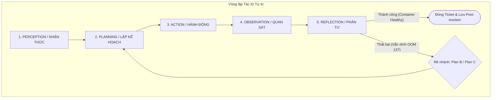
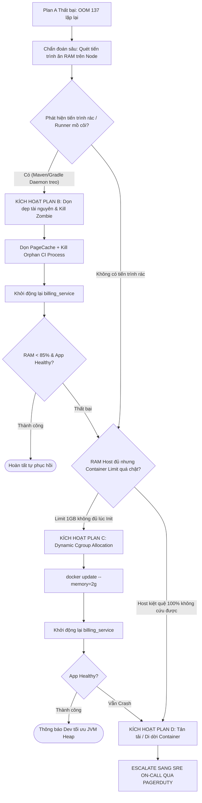

# TÀI LIỆU THIẾT KẾ KIẾN TRÚC TÁC TỬ TỰ TRỊ (SRE AGENTIC LOOP)
**Chuyên đề:** Tự phục hồi sự cố cạn kiệt tài nguyên (OOM - Exit Code 137) trong hạ tầng CI/CD  
**Đơn vị:** DevOps & Cloud Center of Excellence (CoE) – FPT Software  
**Quy mô hạ tầng:** 1.200+ máy chủ Staging/Production & CI/CD Runners  
**Mục tiêu:** Tự động hóa khắc phục sự cố cấp độ L1/L2 lúc nửa đêm, tối ưu MTTR (Mean Time to Resolve) từ 45 phút xuống dưới 2 phút.

---

## 1. MÔ HÌNH HÓA 5 BƯỚC AGENTIC LOOP (PERCEPTION – PLANNING – ACTION – OBSERVATION – REFLECTION)

Hệ thống áp dụng chu trình khép kín 5 mắt xích khi phát hiện thông điệp cảnh báo:  
`"Server staging-node-04: Memory usage 98%, Docker container billing_service status: Exited (137) Out of Memory"`



### Bước 1: Nhận thức (Perception / Sense)
* **Thu nhận tín hiệu:** Webhook từ Prometheus Alertmanager và Grafana Loki bắn về Agent Gateway khi máy chủ `staging-node-04` chạm ngưỡng cảnh báo P1.
* **Bóc tách thực thể (Entity Parsing):**
  * `Host`: `staging-node-04` (IP: `10.20.14.88`, thuộc cụm Staging CI/CD).
  * `Target`: Docker container `billing_service`.
  * `Symptom`: Host Memory Utilization = `98%`, Container State = `Exited`.
  * `Exit Code`: `137` = $128 + 9$ (Tiến trình bị kernel gửi tín hiệu `SIGKILL` do Linux kernel Out-Of-Memory Killer kích hoạt).
* **Bổ sung ngữ cảnh (Context Enrichment):** Agent tự động gọi API giám sát để lấy hiện trạng tức thời:
  * Node RAM: $31.4 / 32 \text{ GB}$ (gần cạn kiệt).
  * Swap: $0 \text{ MB}$ (hạ tầng Kubernetes/Docker tiêu chuẩn đã tắt swap).
  * Container limit cấu hình hiện tại: `mem_limit: 1024m`.

### Bước 2: Lập kế hoạch (Planning)
* **Xác lập mục tiêu:** Khôi phục `billing_service` về trạng thái `Running` và đưa tải RAM của node về mức an toàn ($< 85\%$).
* **Đánh giá rủi ro (Risk Evaluation):** Node thuộc môi trường `staging`, dịch vụ không phục vụ khách hàng cuối trực tiếp nhưng chặn luồng CI/CD merge code của 40 lập trình viên.
* **Xây dựng Plan A (Chiến lược khởi động nhanh có điều kiện):**
  1. Kiểm tra nhanh xem OOM xảy ra do rò rỉ nội tại của `billing_service` hay do hiệu ứng "hàng xóm ồn ào" (Noisy Neighbor - các tiến trình khác trên node chiếm dụng).
  2. Nếu tài nguyên khả dụng tức thời $> 1.5 \text{ GB}$: Kích hoạt lệnh `docker start billing_service`.
  3. Đặt thời gian theo dõi (Timeout window): 30 giây.

### Bước 3: Hành động (Action)
* **Kích hoạt công cụ thực thi:** Agent gọi module `SSH_Remote_Executor` hoặc `Docker_Daemon_Socket_API` với định danh phiên bảo mật (mTLS / SSH Key nội bộ).
* **Lệnh thực thi:**
  ```bash
  docker start billing_service
  ```
* **Ghi nhận Audit Log:** Lưu trữ thời điểm kích hoạt (`2026-11-06T00:15:30Z`), PID của tiến trình, và lệnh gọi vào hệ thống kiểm toán của FPT Software.

### Bước 4: Quan sát (Observation)
* **Lấy mẫu trạng thái (Telemetry Polling):** Agent liên tục kiểm tra trạng thái container mỗi 2 giây trong vòng 30 giây thông qua câu lệnh:
  ```bash
  docker inspect --format='{{.State.Status}} {{.State.ExitCode}} {{.State.OOMKilled}}' billing_service
  ```
* **Kết quả đo lường thực tế:**
  * Tại giây thứ 8: `State.Status` = `exited`, `ExitCode` = `137`, `OOMKilled` = `true`.
  * Bộ nhớ node vẫn duy trì ở mức $98.2\%$.
* **Thu thập log sập nguồn (Crash Log Scraping):**
  ```bash
  docker logs --tail 50 billing_service
  # Kết quả: Java HotSpot(TM) 64-Bit Server VM warning: INFO: os::commit_memory failed; error='Cannot allocate memory' (errno=12)
  ```

### Bước 5: Phản tư (Reflection)
* **So sánh kỳ vọng vs Thực tế:**
  * *Kỳ vọng:* Container khởi động thành công, giữ trạng thái `running` ổn định.
  * *Thực tế:* Container chết ngay lập tức (CrashLoopBackOff) cùng mã lỗi 137.
* **Đánh giá nguyên nhân cốt lõi (Root Cause Hypothesis):**
  * Hành động "Khởi động lại mù quáng" (Naive Restart) thất bại hoàn toàn.
  * *Lý do:* Máy chủ `staging-node-04` đã bị cạn kiệt RAM vật lý toàn diện. Dù container được cấp quota 1GB, hệ điều hành (Host OS) không thể cấp phát thêm bộ nhớ ảo (Virtual Memory) lúc JVM boot lên, dẫn đến việc bị OOM Killer bắn hạ ngay lập tức.
* **Kết luận của Agent:** Khóa Plan A. Chuyển trạng thái sang **Cơ chế Tự phục hồi rẽ nhánh (Self-healing Branching)**.

---

## 2. CƠ CHẾ PHẢN TƯ & TỰ PHỤC HỒI ĐA TẦNG (SELF-HEALING BRANCHING LOGIC)

Khi chu kỳ đầu tiên thất bại, Agent kích hoạt cây quyết định chẩn đoán nguyên nhân sâu và lần lượt thực thi các phương án dự phòng.



### Chẩn đoán sâu (Deep-dive Diagnostic Inspection)
Trước khi chọn Plan B hay Plan C, Agent chạy script bóc tách bảng phân bổ bộ nhớ:
```bash
# 1. Quét top 5 tiến trình chiếm RAM nhất máy chủ
ps aux --sort=-%mem | awk 'NR<=6 {print $2, $3, $4, $11}'

# 2. Kiểm tra bộ nhớ đệm Buffer/Cache của nhân Linux
free -m
```

---

### Kịch bản chi tiết: Plan B & Plan C

#### Kịch bản Plan B: Giải phóng tài nguyên tầng Host & Triệt tiêu tiến trình mồ côi (Resource Reclamation)
* **Điều kiện kích hoạt:** Agent phát hiện bộ nhớ bị chiếm bởi:
  * Nhiều tiến trình `jenkins-agent`, `gradle-daemon` hoặc `pytest` đã kết thúc trên giao diện CI nhưng tiến trình con bên dưới bị treo (Orphan/Zombie processes) từ các đợt build lúc chiều.
  * Bộ nhớ đệm tầng nhân (`buff/cache`) chiếm giữ quá nhiều RAM chưa chịu giải phóng.
* **Hành động thực thi của Agent:**
  1. **Thu hồi PageCache:** Đồng bộ dữ liệu xuống đĩa và xả cache an toàn:
     ```bash
     sync; echo 3 > /proc/sys/vm/drop_caches
     ```
  2. **Tiêu diệt tiến trình rác (Prune Rogue Runners):** Gửi tín hiệu `SIGTERM` (sau đó là `SIGKILL` nếu quá 5s) tới các tiến trình CI Runner mồ côi đã tồn tại $> 6$ giờ không có parent process:
     ```bash
     kill -9 <PID_orphan_gradle>
     ```
  3. **Tái khởi động lại container mục tiêu:**
     ```bash
     docker start billing_service
     ```
* **Đánh giá sau Plan B:** Nếu RAM máy chủ hạ xuống còn $68\%$ và container duy trì trạng thái `Up` trong 60 giây $\rightarrow$ **Thành công**. Đóng sự cố.

#### Kịch bản Plan C: Điều chỉnh hạn mức động tầng Cgroup (Dynamic Resource Adjustment)
* **Điều kiện kích hoạt:** Sau khi dọn dẹp ở Plan B, RAM máy chủ đã hạ xuống mức an toàn ($70\%$), nhưng khi start lại thì `billing_service` vẫn lập tức sập 137.
* **Phân tích của Agent:**
  * Lỗi không nằm ở thiếu RAM toàn cục mà do **Cgroup Memory Limit** cấu hình cho container quá thấp (`1024 MB`). Trong khi đó, dịch vụ `billing_service` mới được deploy bản build mới chứa thêm thư viện nặng, lúc khởi động (Init phase) cần nạp dữ liệu vào Heap Memory vượt quá 1GB.
* **Hành động thực thi của Agent:**
  1. Nâng tạm thời giới hạn bộ nhớ (Hot-patch cgroup mà không cần viết lại docker-compose/K8s manifest):
     ```bash
     docker update --memory=2048m --memory-swap=2048m billing_service
     ```
  2. Khởi động lại dịch vụ:
     ```bash
     docker start billing_service
     ```
  3. Kích hoạt Endpoint Healthcheck để thẩm định:
     ```bash
     curl -f http://localhost:8080/actuator/health || exit 1
     ```
* **Đánh giá sau Plan C:** Dịch vụ phản hồi HTTP 200. Container chiếm dụng $1.4 \text{ GB}$ RAM $\rightarrow$ Khôi phục thành công. Hệ thống tự động tạo một ticket Jira gán cho Dev Team: *"Phát hiện billing_service vượt ngưỡng bộ nhớ cơ sở (vượt 1GB), cần tối ưu lại JVM `-Xmx` hoặc cập nhật manifest chính thức"*.

---

## 3. RANH GIỚI CAN THIỆP CỦA CON NGƯỜI (HUMAN-IN-THE-LOOP - HITL MATRIX)

Để đảm bảo an toàn tuyệt đối cho hệ thống và ngăn ngừa rủi ro Agent "phản pháo" phá hủy môi trường, mọi hành động can thiệp được phân định thành 2 nhóm dựa trên Ma trận Rủi ro (Risk-Impact Matrix).

| Nhóm hành động | Thao tác kỹ thuật cụ thể | Đánh giá rủi ro & Cơ sở kỹ thuật | Cơ chế phê duyệt & Giám sát |
| :--- | :--- | :--- | :--- |
| **TỰ ĐỘNG THỰC THI (Auto-Remediation)**<br>*(Low Risk / Không ảnh hưởng Data)* | **1. Khởi động lại Container:**<br>`docker restart <container>` (Giới hạn: Tối đa 2 lần). | **Rủi ro thấp:** Dịch vụ vốn dĩ đã chết (Exited). Việc thử restart không làm mất mát thêm dữ liệu. | Tự kích hoạt ngay lập tức; log lại audit trail trong Splunk/ELK. |
| | **2. Xả Cache Hệ thống Host:**<br>`echo 3 > /proc/sys/vm/drop_caches`. | **Rủi ro rất thấp:** Linux tự động đồng bộ dirty pages (qua `sync`); giải phóng tài nguyên an toàn. | Tự động thực thi khi Host RAM $> 95\%$. |
| | **3. Tiêu diệt tiến trình CI treo:**<br>Kill các build runner orphaned (thời gian sống $> 6\text{h}$, parent PID = 1). | **Rủi ro thấp:** Tiến trình không thuộc core service, không có kết nối client hoạt động. | Kiểm tra đối chiếu Process Table trước khi gửi `SIGKILL`. |
| | **4. Dọn dẹp tài nguyên rác Docker:**<br>`docker system prune -f --volumes=false`. | **Rủi ro thấp:** Chỉ xóa dangling images, networks không dùng; tuyệt đối không xóa persistent volumes. | Tự động chạy định kỳ khi disk space hoặc RAM phân mảnh cao. |
| | **5. Nâng tạm thời Memory Limit:**<br>`docker update --memory` tối đa $+100\%$ so với mức ban đầu (chỉ áp dụng Staging). | **Rủi ro trung bình:** Nằm trong ngân sách tài nguyên rảnh rỗi của Node. | Tự động áp dụng và tự động tạo ticket Jira cảnh báo cho Dev. |
| **CHỜ PHÊ DUYỆT (Admin Approval)**<br>*(High Risk / Tác động toàn cục)* | **1. Khởi động lại toàn bộ Node (Reboot Server):**<br>`sudo reboot` hoặc `init 6`. | **Rủi ro cực cao:** Cắt đứt kết nối của hàng chục container/dịch vụ khác đang cùng chạy trên server `staging-node-04`. | **Bắt buộc dừng:** Gửi cảnh báo đính kèm nút Approve trên Telegram/Teams bot tới SRE On-call. |
| | **2. Tăng Memory vượt quá 85% năng lực Host:**<br>Cấp thêm tài nguyên cho container khiến tổng RAM cam kết vượt ngưỡng vật lý. | **Rủi ro cao:** Dễ dẫn đến hiệu ứng domino làm sập tiếp các dịch vụ quan trọng khác trên cùng node. | Gửi kèm báo cáo dung lượng máy chủ để Tech Lead phê duyệt. |
| | **3. Xóa Data Volumes hoặc Rollback Database:**<br>`docker volume rm` hoặc rollback các schema di trú dữ liệu. | **Rủi ro thảm họa (Disaster):** Nguy cơ mất mát dữ liệu trạng thái (Stateful data) không thể phục hồi. | Chặn hoàn toàn quyền hạn của Agent ở tầng phân quyền Linux (No `sudo rm -rf`). |
| | **4. Dừng (Stop/Kill) các dịch vụ lân cận:**<br>Tắt các container khác để nhường RAM cho `billing_service`. | **Rủi ro cao:** Gây gián đoạn chéo dịch vụ (Cross-service outage) của các nhóm dự án khác. | Bắt buộc phải có xác nhận phân cấp ưu tiên từ Release Manager. |
| | **5. Tự động chuyển đổi cụm (Cluster Drain & Failover):**<br>Đưa máy chủ vào trạng thái `Unschedulable` và di dời hàng loạt pod/container. | **Rủi ro cao:** Gây tải đột biến (Traffic Spike) sang các node còn lại, dễ gây nghẽn mạng toàn cụm. | Hệ thống chuẩn bị sẵn payload, chỉ kích hoạt khi Admin nhấn xác nhận trong 60 giây. |

---

### Mẫu Thông điệp Phê duyệt Khẩn cấp gửi tới Admin (HITL Escalation Notification)

Khi các phương án tự trị chạm ngưỡng cần cấp quyền, Agent sẽ gửi ngay một **Interactive Action Card** qua Telegram Bot / Microsoft Teams tới SRE trực đêm:

```markdown
🚨 [CRITICAL ALERT] SRE AGENT REQUIRES HUMAN APPROVAL
────────────────────────────────────────────────────
📍 Máy chủ: staging-node-04 (10.20.14.88)
⚠️ Sự cố: Cạn kiệt RAM (98%), billing_service dính OOM (137)
🔍 Đã thử tự phục hồi: Plan A (Restart) ❌ | Plan B (Drop Caches) ❌
💡 Đề xuất hành động khẩn cấp từ AI:
   "Cần nâng cgroup memory lên 2048M và cô lập 2 tiến trình CI runner đang ngốn 6GB RAM"
────────────────────────────────────────────────────
⏳ Thời gian chờ phê duyệt: 120 giây (Hết giờ sẽ giữ nguyên hiện trạng)
[ ✅ PHÊ DUYỆT THỰC THI ]      [ ⛔ TỪ CHỐI / CHUYỂN SANG THỦ CÔNG ]
```

---

## 4. KẾT LUẬN & GIÁ TRỊ VẬN HÀNH CHO FPT SOFTWARE

Thiết kế vòng lặp **SRE Agentic Loop** trên đây mang lại 3 chuyển biến mang tính đột phá cho hạ tầng 1.200 máy chủ của FPT Software:
1. **Xóa bỏ "Báo động giả & Đánh thức vô ích":** Agent tự động giải quyết dứt điểm các lỗi OOM cơ bản (chiếm 70% số lượng sự cố lúc nửa đêm) mà không cần đánh thức kỹ sư on-call.
2. **Ngăn chặn vòng lặp sập vô tận (CrashLoop):** Nhờ cơ chế **Phản tư (Reflection)**, Agent không hành động máy móc (không lặp lại thao tác restart vô nghĩa), mà biết phân tích metric để tìm gốc rễ và tự chuyển sang Plan B, Plan C.
3. **An toàn kiểm soát tuyệt đối (Guardrails):** Ranh giới phân định rõ ràng giữa **Auto-remediation** và **HITL Approval** đảm bảo AI hoạt động trong hành lang an toàn, không bao giờ tự ý đưa ra các quyết định có thể gây mất dữ liệu hoặc gián đoạn toàn hệ thống.
